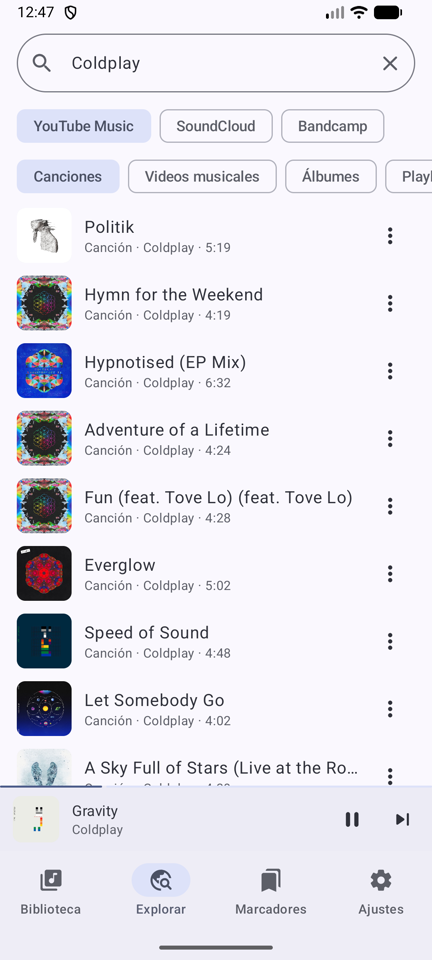
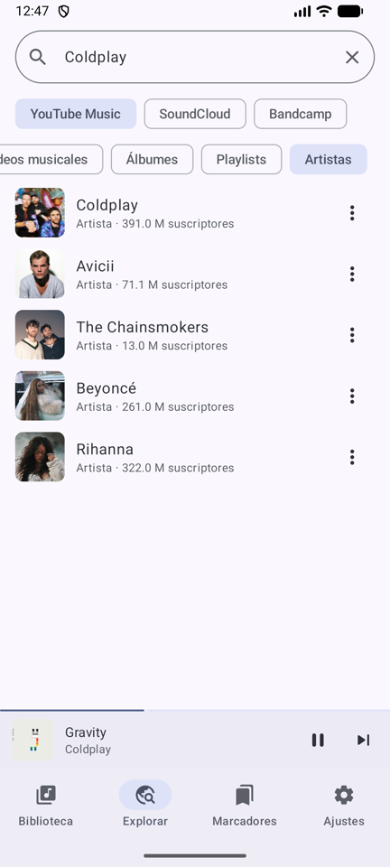
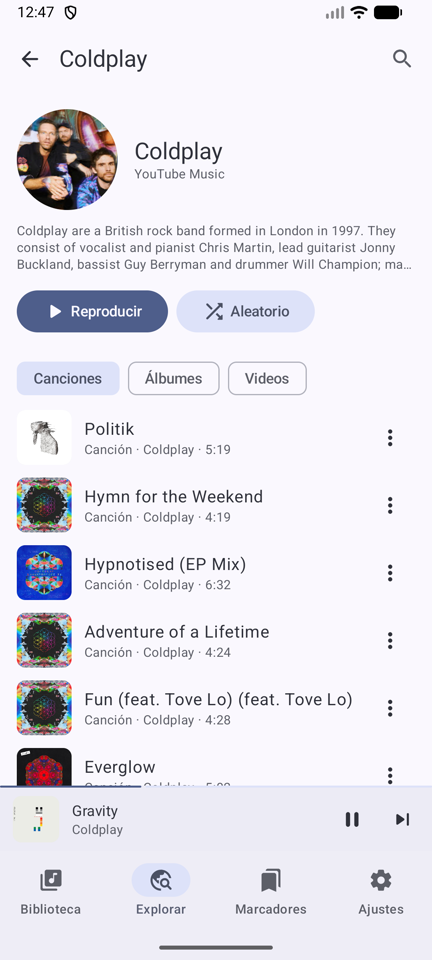
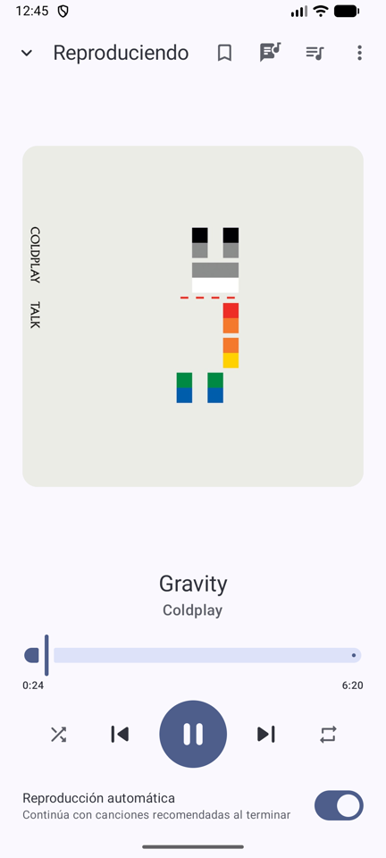
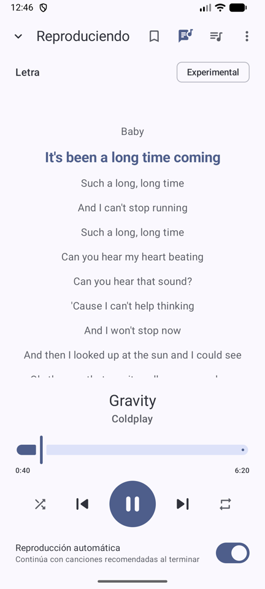
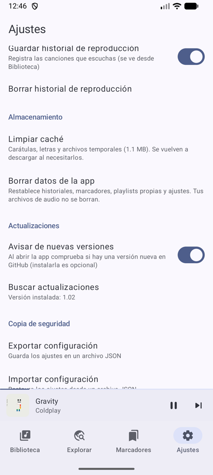

# Open Music Streaming

Aplicación Android (Kotlin + Jetpack Compose Material 3) para **escuchar música por streaming y descargarla
para oírla sin conexión**. Busca canciones, álbumes, playlists y artistas en **YouTube Music, SoundCloud y
Bandcamp**, y guarda lo que quieras en una carpeta de tu dispositivo, con etiquetas y carátula, sin recodificar.

**No requiere cuenta ni inicio de sesión**, no tiene publicidad y no envía datos personales.

> Versión actual: **1.02**. Licencia [GPLv3](LICENSE).

## Capturas de pantalla

<p align="center">
  
  
  
  
</p>
<p align="center">
  
  
</p>

| Búsqueda                                         | Artistas          | Perfil del artista                               | Reproductor              | Letra                       | Ajustes                        |
| ------------------------------------------------ | ----------------- | ------------------------------------------------ | ------------------------ | --------------------------- | ------------------------------ |
| Canciones, videos musicales, álbumes y playlists | Filtro «Artistas» | Canciones, álbumes y videos, con búsqueda propia | Controles, cola y menú ⋮ | Sincronizada con la canción | Caché, datos y actualizaciones |

## Características

### Explorar y reproducir

- Búsqueda de **canciones, videos musicales, álbumes, playlists y artistas** en YouTube Music, SoundCloud y Bandcamp (solo contenido musical).
- También puedes **pegar un enlace** (incluso de contenido no listado) para abrirlo directamente.
- **Reproducción por streaming** en segundo plano, con controles en la notificación y la pantalla de bloqueo.
- Reproductor completo: cola reordenable arrastrando, aleatorio, repetición, reproducción automática de recomendados y opción de ver el video.
- Pausa automática al conectar o desconectar audífonos; ahorro de datos con redes móviles.

### Artistas

- **Perfil de artista** con foto, descripción, canciones, álbumes, videos musicales y playlists.
- **Búsqueda dentro del perfil** para encontrar contenido de ese artista.
- Desde el reproductor: **Ver artista** y **Ver álbum**.

### Letras (experimental)

- **Letra sincronizada** durante la reproducción, con la línea actual resaltada; tocar una línea salta a ese momento.
- Las letras provienen de [LRCLIB](https://lrclib.net); no todas las canciones tienen letra.

### Descargas y biblioteca

- Descarga de canciones, álbumes y playlists **sin recodificar** (Opus → Ogg o AAC → M4A) con etiquetas y carátula, en la carpeta que elijas (permiso de carpeta de Android, sin permisos de almacenamiento).
- **Actualización automática de playlists**: se descargan las canciones nuevas y lo que ya tienes se conserva aunque desaparezca de la plataforma.
- Una canción compartida entre playlists se guarda **una sola vez**.
- **Búsqueda en la biblioteca** (canciones, playlists y listas propias).
- **Playlists propias** que mezclan canciones de streaming y descargadas, con orden editable.
- **Historial de reproducción**

### Ajustes y mantenimiento

- Tema claro/oscuro/negro puro y colores dinámicos; calidad y formato de descarga; descargas simultáneas y solo con Wi-Fi.
- Exportar e importar la configuración en un archivo JSON.

## Instalación

1. Descarga el APK de la última versión desde la sección [Releases](https://github.com/mjoacobf/OpenMusicStreaming/releases).
2. Instalar (de ser el caso que Android solicite instalar por fuentes desconocidas, acéptalo)

## Requisitos del sistema Android

| Requisito          | Detalle                                                                                                           |
| ------------------ | ----------------------------------------------------------------------------------------------------------------- |
| Versión de Android | 7.0 o superior                                                                                                    |
| Conexión           | Internet para buscar y reproducir por streaming. Luego lo descargado se reproduce sin conexión                    |
| WebView            | Android System WebView actualizado                                                                                |
| Almacenamiento     | Una carpeta elegida con el selector del sistema para las descargas (la app ocupa alrededor de 20 mb inicialmente) |
| Notificaciones     | Permiso de notificaciones en Android 13+ (controles de reproducción y progreso de descargas)                      |

## Requisitos para clonar y editar el proyecto

| Herramienta        | Versión                                                                                                                    |
| ------------------ | -------------------------------------------------------------------------------------------------------------------------- |
| **JDK**            | 17 o superior (el proyecto se desarrolla con JDK 25)                                                                       |
| **Android Studio** | Versión reciente con soporte para AGP 9.x (o solo las herramientas de línea de comandos del SDK)                           |
| **Android SDK**    | Plataforma **API 37** y _build-tools_ correspondientes; el archivo `local.properties` con `sdk.dir` lo crea Android Studio |
| **Gradle**         | 9.5.0, mediante el _wrapper_ incluido (`./gradlew`); no hace falta instalarlo                                              |
| **Kotlin**         | 2.4.x (integrado en AGP; no se aplica el plugin `kotlin-android`)                                                          |
| **Red**            | Acceso a Maven Central, Google y [JitPack](https://jitpack.io) (de ahí se descarga NewPipeExtractor)                       |
| **Git**            | Para clonar el repositorio                                                                                                 |

**Observación:** Este proyecto viene con Graphify integrado y skills para Claude Code, por lo que se recomienda revisar las skills instaladas y actualizar el grafo conforme se vayan realizando cambios.

```bash
git clone https://github.com/mjoacobf/OpenMusicStreaming.git
cd OpenMusicStreaming

./gradlew :app:assembleDebug
./gradlew :core:download:testDebugUnitTest
./gradlew :app:assembleRelease
```

## Arquitectura del proyecto

| Módulo              | Responsabilidad                                                                                          |
| ------------------- | -------------------------------------------------------------------------------------------------------- |
| `app`               | `Application` (Koin, NewPipe, Coil), `MainActivity`, navegación (Navigation 3), aviso de actualización   |
| `core:model`        | Modelos puros, `AppSettings` (serializable a JSON) y letras (LRC)                                        |
| `core:navigation`   | Rutas (`NavKey`) e interfaz `Navigator`                                                                  |
| `core:designsystem` | Tema Material 3, componentes y selector de carpeta (SAF)                                                 |
| `core:database`     | Room: canciones, playlists, marcadores, historial                                                        |
| `core:datastore`    | Ajustes con guardado automático (DataStore)                                                              |
| `core:extractor`    | NewPipeExtractor, poToken (WebView), `YoutubeDataSource` por bloques                                     |
| `core:data`         | Repositorios (streaming, biblioteca, letras, actualizaciones, mantenimiento) e inyección de dependencias |
| `core:media`        | `PlaybackService` (Media3), cola, reproducción automática, pausa por audífonos                           |
| `core:download`     | Descargas y sincronización (WorkManager), remux sin recodificar con etiquetas                            |
| `feature:*`         | Pantallas: biblioteca, explorar, reproductor, marcadores, ajustes                                        |

La configuración Gradle común está en `build-logic/` (plugins de convención `oms.android.*`).
Más detalle en [`docs/ARCHITECTURE.md`](docs/ARCHITECTURE.md), [`docs/DECISIONS.md`](docs/DECISIONS.md) y [`docs/TESTING.md`](docs/TESTING.md).

## Referencias y herramientas utilizadas

- [NewPipe](https://github.com/TeamNewPipe/NewPipe) / NewPipeExtractor: búsqueda, extracción,
  poToken, peticiones a googlevideo y conversión WebM→Ogg (código adaptado, GPLv3).
- [Simple Music Player](https://github.com/Anrimian/music-player): comportamiento del reproductor.
- [youtube_music_playlist_downloader](https://github.com/onnowhere/youtube_music_playlist_downloader):
  lógica de sincronización de playlists.
- [LRCLIB](https://lrclib.net): letras sincronizadas.

## Aviso

Esta aplicación no está afiliada a YouTube, SoundCloud ni Bandcamp. Úsala respetando los términos de
cada servicio y los derechos de autor de los artistas.

## Licencia

Open Music Streaming es software libre bajo la [GNU General Public License v3.0](LICENSE).
